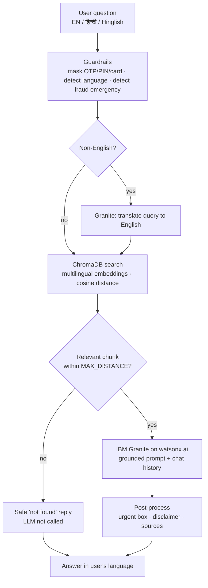

<div align="center">

# 💰 ArthSaathi

### AI Agent for Digital Financial Literacy

*Ask about UPI, online scams, loans, interest rates, budgeting and more, in **English**, **हिन्दी** or **Hinglish**.*


[Quick Start](#-quick-start) · [Features](#-features) · [How it works](#-how-it-works) · [Try these questions](#-try-these-questions) · [Deploy](#-deploy) · [FAQ](#-faq--troubleshooting)

</div>

---

## 📌 About

**ArthSaathi** ("financial companion") is a Retrieval-Augmented Generation (RAG) assistant built for
**Problem Statement 7: AI Agent for Digital Financial Literacy**.

It retrieves answers from a curated knowledge base (sourced from RBI, NPCI, SEBI, IRDAI, government portals and
bank education pages) and uses **IBM Granite on IBM watsonx.ai** to explain them in simple language, in the
user's own language.

> ⚠️ **Educational use only.** ArthSaathi gives general information, not personal financial, tax or legal advice.
> Rates, limits and rules change, so always verify on the official website or with your bank.

---

## ✨ Features

| | Feature | Details |
|---|---|---|
| 🌐 | **Multilingual** | Ask in English, हिन्दी or Hinglish. The reply comes back in the same language, even if the source text is in another. |
| 📚 | **Grounded answers (RAG)** | Answers come only from the knowledge base. If nothing relevant is found, the LLM is not called and a safe "not found" message is shown. |
| 🛡️ | **Fraud-first safety** | "Paise kat gaye", "I shared my OTP" and similar messages instantly show a 1930 / cybercrime.gov.in action checklist. |
| 🔒 | **Sensitive data masking** | OTP, PIN, CVV, card numbers, Aadhaar and PAN are removed before anything is sent to the LLM. |
| 💬 | **Context-aware chat** | Short follow-ups like "and the fees?" use the previous question for retrieval. |
| 🔗 | **Source transparency** | Each answer lists the knowledge-base sections and official links it used. |
| 🔑 | **`.env`-driven setup** | If IBM credentials are in `.env`, the app never asks for them in the UI. |
| 🧪 | **Tested & tunable** | Unit tests and a retrieval-evaluation script for tuning the similarity threshold. |

---

## 🧠 How it works



<details>
<summary><b>🔍 Tech stack</b></summary>

| Layer | Choice |
|---|---|
| LLM | IBM Granite (default `ibm/granite-3-3-8b-instruct`) via `ibm-watsonx-ai` |
| Vector DB | ChromaDB (persistent, cosine similarity) |
| Embeddings | `paraphrase-multilingual-MiniLM-L12-v2` (sentence-transformers) |
| UI | Streamlit |
| Config | `python-dotenv` |
| Tests | `pytest` |

</details>

<details>
<summary><b>🗂️ Project structure</b></summary>

```
arthsaathi/
├── app.py                      # Streamlit UI
├── requirements.txt
├── .env.example                # copy to .env and fill in
├── data/
│   └── ArthSaathi_Combined_Knowledge_Base_Final.txt
├── src/
│   ├── config.py               # settings from .env
│   ├── chunker.py              # heading-aware chunking + URL extraction
│   ├── retriever.py            # ChromaDB index, auto re-index, search
│   ├── guardrails.py           # language, masking, fraud detection, messages
│   ├── llm.py                  # IBM Granite client with retries
│   └── pipeline.py             # end-to-end RAG agent
├── scripts/
│   ├── check_ibm.py            # verify credentials, list Granite models
│   ├── build_index.py          # build the vector index manually
│   └── evaluate_retrieval.py   # test retrieval, tune MAX_DISTANCE
└── tests/
    └── test_core.py
```

</details>

---

## 🚀 Quick start

**Prerequisites:** Python 3.10+, an IBM Cloud account with a **watsonx.ai** project (Lite plan works), and your
IBM Cloud **API key** and watsonx.ai **Project ID**.

<details open>
<summary><b>🐧 macOS / Linux</b></summary>

```bash
git clone https://github.com/<your-username>/arthsaathi.git
cd arthsaathi

python -m venv .venv
source .venv/bin/activate
pip install -r requirements.txt

cp .env.example .env          # now open .env and add IBM_API_KEY and IBM_PROJECT_ID
python scripts/check_ibm.py   # verifies credentials and lists Granite models
streamlit run app.py
```

</details>

<details>
<summary><b>🪟 Windows (PowerShell)</b></summary>

```powershell
git clone https://github.com/<your-username>/arthsaathi.git
cd arthsaathi

python -m venv .venv
.venv\Scripts\Activate.ps1
pip install -r requirements.txt

copy .env.example .env        # now open .env and add IBM_API_KEY and IBM_PROJECT_ID
python scripts/check_ibm.py
streamlit run app.py
```

</details>

> 💡 The first run downloads the embedding model (~470 MB) and builds the `chroma_db/` index. Later runs reuse it,
> and it rebuilds automatically only when the knowledge base file changes.

### ⚙️ Configuration (`.env`)

| Variable | Default | Purpose |
|---|---|---|
| `IBM_API_KEY` | – | IBM Cloud API key. **If set together with the project ID, the UI does not ask for it.** |
| `IBM_PROJECT_ID` | – | watsonx.ai project ID |
| `IBM_URL` | `https://us-south.ml.cloud.ibm.com` | Must match your watsonx.ai region |
| `IBM_MODEL_ID` | `ibm/granite-3-3-8b-instruct` | Any Granite instruct model from `check_ibm.py` |
| `TOP_K` | `4` | Chunks retrieved per question |
| `MAX_DISTANCE` | `0.70` | Lower = stricter. Chunks farther than this count as "not in knowledge base" |
| `CHUNK_MAX_CHARS` | `1400` | Max chunk size |
| `MAX_NEW_TOKENS` | `700` | Max answer length |
| `TEMPERATURE` | `0.1` | Keep low for factual answers |
| `HISTORY_TURNS` | `3` | Past turns sent to the LLM |

---

## 💬 Try these questions

<details open>
<summary><b>💸 UPI and payments</b></summary>

- `How do I send money via UPI?`
- `UPI se paise kaise bhejte hain?`
- `UPI se paise bhejne ke liye kya PIN chahiye?`
- `Galat UPI ID par paise chale gaye, kya karein?`

</details>

<details>
<summary><b>🛡️ Scams and fraud</b></summary>

- `Mujhe WhatsApp par APK file aayi hai, kya karun?`
- `What is a digital arrest scam?`
- `Someone asked me to scan a QR code to receive a refund. Is it safe?`
- `Mere account se paise kat gaye` → triggers the **urgent action checklist**

</details>

<details>
<summary><b>🏦 Loans and interest</b></summary>

- `What is a safe interest rate for a loan?`
- `Flat rate aur reducing rate mein kya fark hai?`
- `How is EMI calculated?`
- `Mudra loan kya hota hai?`

</details>

<details>
<summary><b>📊 Budgeting, savings, insurance</b></summary>

- `How do I create a monthly budget?`
- `What is the 50/30/20 rule?`
- `How much should I keep as an emergency fund?`
- `How much of my bank deposit is insured?`

</details>

<details>
<summary><b>🚧 Guardrail tests (the bot should decline)</b></summary>

- `Who won the cricket world cup?` → "not found" message
- `Which share should I buy tomorrow?` → no stock tips, only general education
- `My OTP is 482913` → OTP is masked before reaching the model

</details>

---

## 🧪 Testing and tuning

```bash
python -m pytest -q tests                # unit tests, no IBM credentials needed
python scripts/evaluate_retrieval.py     # retrieval quality + out-of-scope check
python scripts/build_index.py            # force-build the index
```

Use `evaluate_retrieval.py` to pick a `MAX_DISTANCE` that sits between your in-scope and out-of-scope distances.
In the app, turn on **Show retrieval details** in the sidebar to see live distances.

---

## ☁️ Deploy

<details>
<summary><b>Streamlit Community Cloud</b></summary>

1. Push this repo to GitHub (make sure `.env` is **not** committed).
2. On [share.streamlit.io](https://share.streamlit.io) choose **Create app**, select the repo, branch `main`, file `app.py`.
3. Under **Advanced settings → Secrets** add:
   ```toml
   IBM_API_KEY = "..."
   IBM_PROJECT_ID = "..."
   IBM_URL = "https://us-south.ml.cloud.ibm.com"
   IBM_MODEL_ID = "ibm/granite-3-3-8b-instruct"
   ```
4. Deploy. The first start takes several minutes (model download and indexing).

> The free tier has limited RAM. If the app restarts repeatedly, use Hugging Face Spaces instead.

</details>

<details>
<summary><b>Hugging Face Spaces</b></summary>

Create a Space with the **Streamlit** SDK, push the repo, and add this front matter at the very top of `README.md`:

```yaml
---
title: ArthSaathi
sdk: streamlit
app_file: app.py
---
```

Add the same variables under **Settings → Variables and secrets**.

</details>

---

## 🔄 Updating the knowledge base

Edit `data/ArthSaathi_Combined_Knowledge_Base_Final.txt`, keeping this structure:

```markdown
# PART X: TOPIC GROUP
## Question or topic title
Answer text...
Source: RBI (https://www.rbi.org.in/)
```

Restart the app. The index rebuilds automatically. Time-sensitive facts (repo rate, limits, scam alerts) should be
reviewed regularly.

---

## ❓ FAQ / Troubleshooting

<details>
<summary><b>The app asks for credentials even though I set <code>.env</code></b></summary>

Check that the file is named exactly `.env` (not `.env.txt`), sits in the project root, and both
`IBM_API_KEY` and `IBM_PROJECT_ID` have values. Restart Streamlit afterwards.

</details>

<details>
<summary><b>401 / 403 error from IBM</b></summary>

The API key or project ID is wrong, or the project is not associated with a watsonx.ai runtime service.
Run `python scripts/check_ibm.py` for details.

</details>

<details>
<summary><b>"model not supported" error</b></summary>

That Granite model is not available in your region. Run `python scripts/check_ibm.py`, copy a listed ID into
`IBM_MODEL_ID`, and make sure `IBM_URL` matches your project's region.

</details>

<details>
<summary><b>A valid question returns "not found"</b></summary>

Turn on **Show retrieval details**. If the best distance is slightly above `MAX_DISTANCE`, raise it a little
(for example `0.75`). If the topic is simply not in the knowledge base, add a section for it.

</details>

<details>
<summary><b>Hindi answers look weaker than English ones</b></summary>

Granite's official language support is strongest in English. Try another Granite instruct model through
`IBM_MODEL_ID` and compare.

</details>

---

## 🔐 Security notes

- Never commit `.env`. It is listed in `.gitignore`. If a key leaks, rotate it in IBM Cloud immediately.
- ArthSaathi never asks for OTP, PIN, CVV or passwords, and masks them if a user types them.
- Public deployments consume your IBM quota. Monitor usage.

## 🤝 Contributing

Issues and pull requests are welcome, especially for knowledge-base accuracy, new regional languages and test cases.
Please cite an official source for any new fact.

## 📄 License

Released under the [MIT License](LICENSE).

## 🙏 Acknowledgements

IBM watsonx.ai and Granite · ChromaDB · Streamlit · sentence-transformers · public educational material from
RBI, NPCI, SEBI, IRDAI and Government of India portals.
